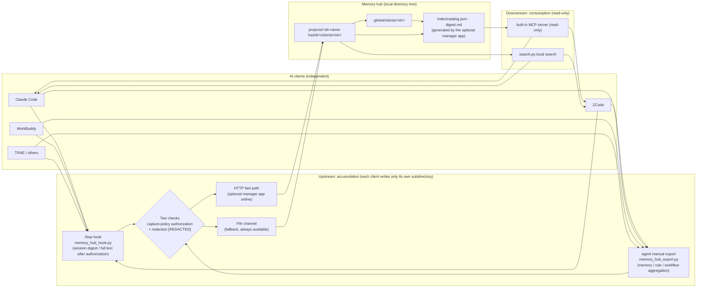
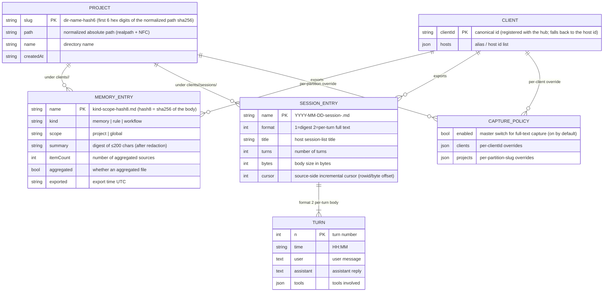

<p align="center">
  <a href="README.md">简体中文</a> ·
  <a href="README.zh-Hant.md">繁體中文</a> ·
  **English** ·
  <a href="README.fr.md">Français</a> ·
  <a href="README.ja.md">日本語</a> ·
  <a href="README.ru.md">Русский</a>
</p>

# Memory Hub Plugin (Cross-Client Shared Memory Hub)

A local hub that lets multiple AI coding clients **share the same memory**: the architecture conventions you settled in Claude Code, the troubleshooting conclusions recorded in ZCode, and the session outcomes discussed in WorkBuddy all accumulate into one local memory store — searchable and referenceable from any other client.

> **Generic, local-first, bound to no desktop app.** Built on the pure Python standard library (zero third-party dependencies); the core is a file protocol of "one Markdown directory tree + three skills + a built-in read-only MCP server" — it works fully offline with no online service. With an optional companion manager app you additionally get aggregated indexes and an HTTP fast path, but **everything works without it**.

```text
Claude Code ─┐                                     ┌─> ZCode        "What was agreed on this project?"
ZCode       ─┼─ export up ─> Hub directory ─ search down ─> Claude Code
WorkBuddy   ─┤   (aggregate · redact · incremental)   └─> WorkBuddy
TRAE / ... ─┘                    (read-only)
```

## Components

| Skill | Direction | Purpose |
|---|---|---|
| `memory-hub-setup` | Onboarding | Writes the Stop hook / MCP configuration into host configs according to each host's **verified contract**. Idempotent, backs up before writing (`*.hub-bak`), dry-run preview, read-back self-check |
| `memory-hub-export` | Upstream (write) | Exports this client's memories / rules / workflows / sessions to the hub. Aggregation, redaction, content-hash incremental sync |
| `memory-hub-consume` | Downstream (read) | Searches the hub for memories / rules / session digests contributed by other clients. **Read-only**; citations must state the source client and path |

Beyond the skills, the repository ships two more product components:

- `mcp/` — the built-in read-only MCP server (7 tools): any MCP-capable client can search the hub **without installing any skill**; see "MCP Server (Built-in)" below.
- `examples/hub/` — a mini hub you can try immediately; it also serves as the golden baseline for search-parity tests.

Supported hosts (graded by verification status; see `setup.py --list`):
Claude Code, ZCode, Codex, TRAE (International / CN / SOLO), WorkBuddy, Qoder, opencode, MiniMax Code.
Hosts that are unverified or lack a hook mechanism **explicitly refuse** automatic installation and state why — no guessed paths. They use the manual-export channel: functionally equivalent, just not automatic.

## How It Works

### How Memory Is Shared



Three core design constraints:

1. **Isolated writes, shared reads**: each client may only write into its own `clients/<id>/` subdirectory and never touches other clients' data; reads may search across clients.
2. **One partition per project**: the project identifier is computed once as "realpath normalization + first 6 hex digits of sha256" (implemented in `skills/_shared/project_id.py`, the only place in the repository). Symbolic links, letter case, or non-ASCII directory names never split one project into two partitions.
3. **File protocol first**: the hub is just a Markdown directory tree (with YAML frontmatter) that any tool — including humans and other scripts — can read directly; the HTTP fast path is only an accelerator when the optional manager app is online.

### Data Structure (ER)

Hub directory tree (root defaults to `~/MemoryHub`; set the `MEMORY_HUB_ROOT` environment variable to point anywhere):

```text
<memory root>/
├── projects/<dir-name-hash6>/              # project partition (slug derived from the normalized path hash)
│   ├── project.json                        # { path, name, createdAt }
│   └── clients/<clientId>/
│       ├── memory-project-<hash8>.md       # memory (aggregated files carry itemCount / aggregated)
│       ├── rule-project-<hash8>.md         # rule
│       ├── workflow-project-<hash8>.md     # workflow
│       └── sessions/YYYY-MM-DD-session-<sessionId>.md   # session (digest format 1 / full text format 2)
├── global/clients/<clientId>/              # global memories/rules (no project affiliation)
│   └── memory-global-<hash8>.md
├── index/                                  # catalog.json (≤2KB navigation) + digest.md (optional manager app)
└── .state/                                 # client-ids.json · capture-policy.json · hook logs
```

Entity relationships:



Every Markdown entry carries frontmatter (`client / scope / kind / project / summary / exported / itemCount / format / turns …`); the file name is the index: memory/rule/workflow file names embed the body hash (same name means same content — naturally incremental and idempotent), and session file names embed the date and session id.

## Installation

Requires Python 3.8+ (standard library only). **The package must be used as a whole** — `skills/_shared/` and the three skill directories must stay under the same parent directory (scripts locate each other via relative paths).

### Option A: install as a plugin (agent-plugins-compliant clients / ZCode)

The repository ships a `plugin.json` (agent-plugins.org 1.0.0 schema). Clients that support that standard or the ZCode plugin system can add this directory as a plugin directly; `skills/` is discovered automatically.

### Option B: bare skills package

```bash
# 1. Get it
git clone https://github.com/KKDestiny/memory-hub-plugin.git memory-hub-plugin

# 2. Inspect host adapter status (changes nothing)
python3 memory-hub-plugin/skills/memory-hub-setup/scripts/setup.py --list

# 3. Dry run: preview the hook/MCP content to be written
python3 memory-hub-plugin/skills/memory-hub-setup/scripts/setup.py --client claude-code --dry-run

# 4. Write (auto-backs up as *.hub-bak before writing; re-running is idempotent)
python3 memory-hub-plugin/skills/memory-hub-setup/scripts/setup.py --client claude-code

# 5. Read-back self-check: run --dry-run again; written should be empty with nothing left to correct
```

Then register the three directories under `skills/` as your host's skills (copy or symlink them per your host's conventions). After restarting the host, the Stop hook starts accumulating sessions automatically; memory/rule export and search are performed by the agent following each SKILL.md.

**Storage location**: defaults to `~/MemoryHub`; set the `MEMORY_HUB_ROOT` environment variable to point anywhere.

## MCP Server (Built-in)

The repository ships its own read-only MCP server (`mcp/memory-hub-mcp.mjs`, zero-dependency Node 18+): **any MCP-capable client can search the hub without installing this plugin's skills**. Writes remain the export skill's job — the server exposes no write tools.

```json
{
  "mcpServers": {
    "memory-hub": {
      "type": "stdio",
      "command": "node",
      "args": ["/path/to/memory-hub-plugin/mcp/memory-hub-mcp.mjs"],
      "env": { "MEMORY_HUB_ROOT": "/Users/you/MemoryHub" }
    }
  }
}
```

- **Zero config**: agent-plugins-compliant clients auto-discover it via the root `mcp.json` — installing the plugin is enough;
- **Script wiring**: `setup.py --client <id>` writes the entry above automatically (Duti Studio itself bundles this plugin and connects the same way);
- **Tools**: `search_hub` / `read_entry` / `get_session` / `list_partitions` / `list_clients` / `read_catalog` / `hub_stats` (all read-only) — see [mcp/README.md](mcp/README.md);
- To try it on sample data first, point `MEMORY_HUB_ROOT` at this repository's [examples/hub](examples/).

## Usage Walkthroughs (by Client)

Hosts differ in capability, resulting in two post-install shapes: **automatic hosts** (ZCode, Claude Code, WorkBuddy, Qoder — the Stop hook accumulates sessions automatically) and **MCP-only hosts** (Codex, MiniMax Code, opencode, the TRAE family — no usable hook/transcript: reads go through MCP, writes are manual exports).

### ZCode: full-featured shape (auto-accumulation + direct MCP reads)

```bash
# 1. One command wires everything: Stop hook + built-in read-only MCP server (backs up before writing; safe to re-run)
python3 skills/memory-hub-setup/scripts/setup.py --client zcode
# 2. Restart ZCode to take effect
```

After that, **daily use needs zero effort**: at the end of each session the Stop hook automatically writes the digest (per-turn full text once authorized) into the hub's project partition. Ask in a ZCode chat, "what did we agree on for this project?" and the model calls `search_hub` directly and answers with source citations; without MCP configured, the agent runs the search script per the consume skill instead — both read paths are equivalent. To export memories/rules/workflows, just tell the agent in-session; the export skill aggregates and writes them.

### Codex: MCP-only host shape (reads via MCP, writes by hand)

Codex's hook structure is unverified, so the setup script writes MCP only (TOML format):

```bash
python3 skills/memory-hub-setup/scripts/setup.py --client codex --mcp-only   # writes ~/.codex/config.toml
```

Restart Codex and you can search the hub in conversation (`search_hub` etc.). There is no automatic write channel; use the two manual paths:

```bash
# Aggregated export of memories/rules (the agent can also run this via the export skill)
python3 skills/memory-hub-export/scripts/memory_hub_export.py --client codex --kind memory --from-dir <dir> --project <abs project path>
# Bulk import of session history: dry-run first to see "N sessions to import", then drop --dry-run (Codex's plaintext session dir varies by install)
python3 skills/memory-hub-export/scripts/memory_hub_hook.py --client codex --import-all --sessions-dir <your plaintext session dir> --dry-run
```

MiniMax Code, opencode and the TRAE family follow the same shape.

### Claude Code → ZCode: cross-client handoff

On Monday you settle with your team in Claude Code that "this project's ORM is always Drizzle" and it becomes a rule, while the hook auto-accumulates that day's session; on Wednesday you ask ZCode "what's this project's ORM convention?" — `search_hub` hits the rule file claude-code exported to the hub, and the answer cites the source automatically (`claude-code · projects/<partition>/clients/claude-code/rule-project-<hash>.md`). Both clients work on the same repo: their deposits land in the same partition under separate `clients/` subdirectories, mutually visible to searches.

## Adding Another Client

Onboarding a new host = adding one **verified record** to the adapter table (`setup.py --list` shows the existing entries' evidence fields as examples):

| Field | Meaning |
|---|---|
| `hooks.file / shape / events / timeout` | Hook config file location, structure shape (flat / zcode / trae), supported event set |
| `hooks.input` | stdin contract: presence of `transcript_path`, session_id / cwd field names |
| `mcp.file / keys / serverExtra` | MCP config location and schema strictness (whether unknown keys drop the whole entry) |
| `sessions / rules / memories` | Plaintext locations of the three data classes (export/import sources) |
| `status / evidence` | Verification status (verified-auto / verified-manual / unverified) and evidence source |

Hosts without a hook mechanism (e.g. opencode) use manual export: the agent calls `memory_hub_export.py` at the end of a session — functionally equivalent, just not automatic. Any host that can run Python and read its own session storage can onboard fully in manual mode.

## Typical Scenarios

**① Cross-tool handoff**: on Monday you agree with your team in Claude Code that "this project's ORM is always Drizzle" and it becomes a rule; on Wednesday you ask ZCode "what's this project's ORM convention?" — `memory-hub-consume` finds the rule file Claude Code exported to the hub and the answer automatically cites the source (`claude-code · projects/<slug>/clients/claude-code/rule-project-9f3e2a1b.md`).

**② Automatic session accumulation**: nothing to do in daily use. Each client's Stop hook writes every session's digest (per-turn full text once authorized) into the hub's project partition; a month later, "which approaches did we try for that sync conflict last month?" is directly searchable.

**③ History migration**: on a new machine or for a newly onboarded client, tell the agent "import all historical sessions into the memory hub" — `--import-all` first dry-runs and reports "N sessions to import"; after confirmation it imports everything incrementally, and re-running never duplicates entries.

**④ Multiple tools, one project**: you work on the same repo with WorkBuddy by day and ZCode at night — both tools' sessions and memories land under the **same** `projects/<slug>/` partition in their own `clients/` subdirectories (keyed by normalized path); searches see both sides, so the same project never ends up with two divergent memories.

## Security & Privacy

- **Redaction**: before export, the body and digest go through pattern redaction (`sk-…`/`ghp_…`/`xox…` style tokens, `api_key=…` key–value pairs, ≥48-char random strings → `[REDACTED]`). Note this is an **aid, not secret classification**: cases like non-ASCII key names can be missed; do not treat it as the only line of defense, and keep sensitive material out of sessions.
- **Authorization check**: full-text session capture is controlled by `.state/capture-policy.json` (master switch / per-client / per-partition overrides); without authorization it automatically falls back to digest level. The check runs once on the client side and once at ingestion.
- **Trust model**: the hub is a local plaintext directory readable by every process on the machine — it assumes you are the machine's only user. Do not use it on shared machines; consider `chmod 700` on the hub root. See [SECURITY.md](SECURITY.md).

## Known Limitations

- Session reading for hosts like ZCode / Codex depends on the **reverse-engineered schema of their private storage**; a major host upgrade may break it (on failure it degrades to digest level rather than erroring out).
- Memory entries are keyed by "project + kind + body hash": multiple non-aggregated shards of the same project and kind overwrite each other — follow the SKILL.md convention and export in aggregated mode.
- Search is a linear full-text scan; it feels good up to a few hundred entries. Beyond that it needs an index (which the optional manager app can provide).

## Contributing

Commit-message and code-comment conventions: [CONTRIBUTING.md](CONTRIBUTING.md); reporting security issues and the trust model: [SECURITY.md](SECURITY.md); change history: [CHANGELOG.md](CHANGELOG.md).

## License

MIT — see [LICENSE](LICENSE).
