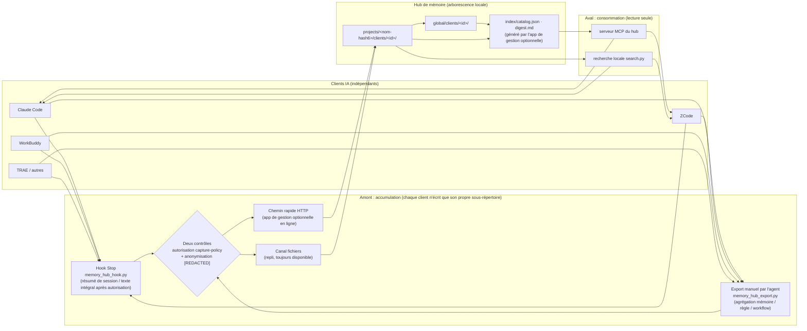
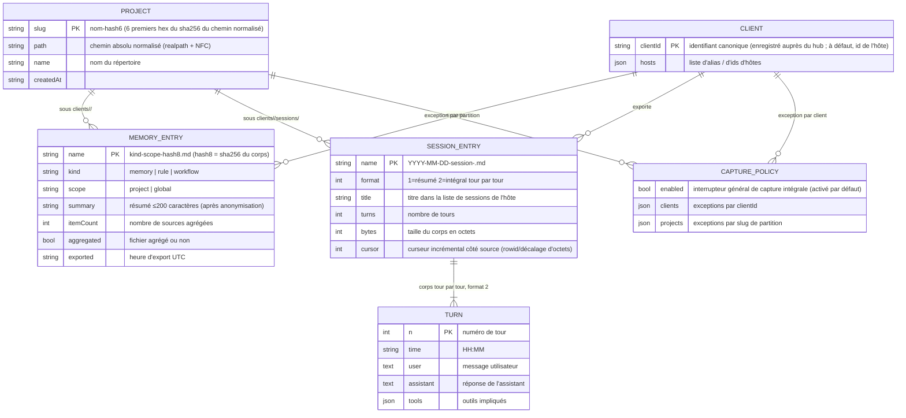

<p align="center">
  <a href="README.md">简体中文</a> ·
  <a href="README.zh-Hant.md">繁體中文</a> ·
  <a href="README.en.md">English</a> ·
  **Français** ·
  <a href="README.ja.md">日本語</a> ·
  <a href="README.ru.md">Русский</a>
</p>

# Memory Hub Plugin (hub de mémoire partagée entre clients)

Un hub local qui permet à plusieurs clients de codage IA de **partager la même mémoire** : les conventions d'architecture décidées dans Claude Code, les conclusions de débogage notées dans ZCode, les résultats de sessions discutés dans WorkBuddy — tout s'accumule dans un seul magasin de mémoire local, consultable et référençable depuis n'importe quel autre client.

> **Générique, local d'abord, lié à aucune application de bureau.** Implémenté avec la bibliothèque standard Python uniquement (zéro dépendance tierce) ; le cœur est un protocole de fichiers « un arbre Markdown + trois skills » — tout fonctionne hors ligne, sans aucun service en ligne. Avec une application de gestion compagnon en option, vous obtenez en plus des index agrégés et un chemin rapide HTTP, mais **tout fonctionne sans elle**.

```text
Claude Code ─┐                                     ┌─> ZCode        « Quelles conventions pour ce projet ? »
ZCode       ─┼─ export ─> Répertoire du hub ─ recherche ─> Claude Code
WorkBuddy   ─┤   (agrégation · anonymisation · incrément) └─> WorkBuddy
TRAE / ... ─┘                    (lecture seule)
```

## Les trois skills

| Skill | Direction | Rôle |
|---|---|---|
| `memory-hub-setup` | Intégration | Écrit le hook Stop / la configuration MCP dans les fichiers des hôtes selon leur **contrat vérifié**. Idempotent, sauvegarde avant écriture (`*.hub-bak`), prévisualisation à sec, auto-contrôle par relecture |
| `memory-hub-export` | Amont (écriture) | Exporte les mémoires / règles / workflows / sessions de ce client vers le hub. Agrégation, anonymisation, incrément par hash de contenu |
| `memory-hub-consume` | Aval (lecture) | Recherche dans le hub les mémoires / règles / résumés de sessions contribués par les autres clients. **Lecture seule** ; toute citation doit indiquer le client source et le chemin |

Hôtes pris en charge (classés par statut de vérification ; voir `setup.py --list`) :
Claude Code, ZCode, Codex, TRAE (International / CN / SOLO), WorkBuddy, Qoder, opencode, MiniMax Code.
Les hôtes non vérifiés ou dépourvus de mécanisme de hooks **refusent explicitement** l'installation automatique et en donnent la raison — aucun chemin n'est deviné. Ils passent par le canal d'export manuel : fonctionnellement équivalent, simplement non automatique.

## Fonctionnement

### Comment la mémoire est partagée



Trois contraintes de conception fondamentales :

1. **Écriture isolée, lecture partagée** : chaque client ne peut écrire que dans son propre sous-répertoire `clients/<id>/` et ne touche jamais aux données des autres ; la lecture, elle, est transversale.
2. **Une seule partition par projet** : l'identifiant de projet est calculé une seule fois selon « normalisation realpath + 6 premiers caractères hexadécimaux du sha256 » (implémenté dans `skills/_shared/project_id.py`, unique dans le dépôt). Liens symboliques, casse ou noms de répertoires non ASCII ne scindent jamais un même projet en deux partitions.
3. **Protocole de fichiers d'abord** : le hub n'est qu'un arbre Markdown (avec frontmatter YAML) que n'importe quel outil — y compris un humain ou un autre script — peut lire directement ; le chemin rapide HTTP n'est qu'un accélérateur quand l'app de gestion optionnelle est en ligne.

### Structure des données (ER)

Arborescence du hub (racine par défaut `~/MemoryHub` ; la variable d'environnement `MEMORY_HUB_ROOT` permet de pointer ailleurs) :

```text
<racine mémoire>/
├── projects/<nom-hash6>/              # partition projet (slug dérivé du hash du chemin normalisé)
│   ├── project.json                   # { path, name, createdAt }
│   └── clients/<clientId>/
│       ├── memory-project-<hash8>.md  # mémoire (les fichiers agrégés portent itemCount / aggregated)
│       ├── rule-project-<hash8>.md    # règle
│       ├── workflow-project-<hash8>.md # workflow
│       └── sessions/YYYY-MM-DD-session-<sessionId>.md   # session (résumé format 1 / intégral format 2)
├── global/clients/<clientId>/         # mémoires/règles globales (sans projet rattaché)
│   └── memory-global-<hash8>.md
├── index/                             # catalog.json (navigation ≤2 Ko) + digest.md (app de gestion optionnelle)
└── .state/                            # client-ids.json · capture-policy.json · journaux de hooks
```

Relations entre entités :



Chaque entrée Markdown embarque un frontmatter (`client / scope / kind / project / summary / exported / itemCount / format / turns …`) ; le nom de fichier est l'index : les noms des mémoires/règles/workflows intègrent le hash du corps (même nom = même contenu — incrémental et idempotent par nature), et ceux des sessions la date et l'identifiant de session.

## Installation

Prérequis : Python 3.8+ (bibliothèque standard uniquement). **Le paquet s'utilise en entier** — `skills/_shared/` et les trois répertoires de skills doivent rester sous le même répertoire parent (les scripts se localisent par chemins relatifs).

### Option A : installer comme plugin (clients conformes agent-plugins / ZCode)

Le dépôt embarque un `plugin.json` (schéma agent-plugins.org 1.0.0). Les clients prenant en charge ce standard ou le système de plugins ZCode peuvent ajouter ce répertoire directement comme plugin ; `skills/` est découvert automatiquement.

### Option B : paquet de skills brut

```bash
# 1. Récupérer
git clone https://github.com/KKDestiny/memory-hub-plugin.git memory-hub-plugin

# 2. Consulter le statut d'adaptation des hôtes (ne modifie rien)
python3 memory-hub-plugin/skills/memory-hub-setup/scripts/setup.py --list

# 3. Essai à sec : prévisualiser le contenu hooks/MCP qui sera écrit
python3 memory-hub-plugin/skills/memory-hub-setup/scripts/setup.py --client claude-code --dry-run

# 4. Écrire (sauvegarde automatique *.hub-bak avant écriture ; ré-exécution idempotente)
python3 memory-hub-plugin/skills/memory-hub-setup/scripts/setup.py --client claude-code

# 5. Auto-contrôle : relancer --dry-run ; written doit être vide et rien à corriger
```

Enregistrez ensuite les trois répertoires sous `skills/` comme skills de votre hôte (copie ou lien symbolique selon les conventions de votre hôte). Après redémarrage de l'hôte, le hook Stop commence à accumuler les sessions automatiquement ; l'export et la recherche des mémoires/règles sont effectués par l'agent conformément à chaque SKILL.md.

**Emplacement de stockage** : par défaut `~/MemoryHub` ; la variable d'environnement `MEMORY_HUB_ROOT` permet de pointer vers n'importe quel répertoire.

## Intégrer un autre client

Intégrer un nouvel hôte = ajouter un **enregistrement vérifié** à la table d'adaptation (`setup.py --list` affiche les champs evidence des entrées existantes à titre d'exemple) :

| Champ | Signification |
|---|---|
| `hooks.file / shape / events / timeout` | Emplacement du fichier de configuration des hooks, forme de structure (flat / zcode / trae), ensemble d'événements pris en charge |
| `hooks.input` | Contrat stdin : présence de `transcript_path`, noms des champs session_id / cwd |
| `mcp.file / keys / serverExtra` | Emplacement de la configuration MCP et rigueur du schéma (les clés inconnues rejettent-elles l'entrée entière ?) |
| `sessions / rules / memories` | Emplacements en clair des trois classes de données (sources d'export/import) |
| `status / evidence` | Statut de vérification (verified-auto / verified-manual / unverified) et source de preuve |

Les hôtes sans mécanisme de hooks (comme opencode) passent par l'export manuel : l'agent appelle `memory_hub_export.py` à la fin de la session — équivalent fonctionnellement, simplement non automatique. Tout hôte capable d'exécuter Python et de lire son propre stockage de sessions peut s'intégrer complètement en mode manuel.

## Scénarios types

**① Relais entre outils** : lundi, vous convenez dans Claude Code avec votre équipe que « l'ORM de ce projet est toujours Drizzle », ce qui devient une règle ; mercredi, vous demandez à ZCode « quelle est la convention ORM de ce projet ? » — `memory-hub-consume` retrouve le fichier de règles exporté par Claude Code et la réponse cite automatiquement la source (`claude-code · projects/<slug>/clients/claude-code/rule-project-9f3e2a1b.md`).

**② Accumulation automatique des sessions** : rien à faire au quotidien. Le hook Stop de chaque client écrit le résumé de chaque session (texte intégral tour par tour une fois autorisé) dans la partition projet correspondante du hub ; un mois plus tard, « quelles approches avions-nous essayées pour ce conflit de synchronisation ? » se retrouve directement.

**③ Migration de l'historique** : sur une nouvelle machine ou pour un client nouvellement intégré, dites à l'agent « importe toutes les sessions historiques dans le hub » — `--import-all` commence par un essai à sec et annonce « N sessions à importer » ; après confirmation, l'import est complet et incrémental, et le relancer ne crée jamais de doublons.

**④ Plusieurs outils, un même projet** : vous travaillez sur le même dépôt avec WorkBuddy le jour et ZCode le soir — les sessions et mémoires des deux outils atterrissent dans la **même** partition `projects/<slug>/`, chacun dans son sous-répertoire `clients/` (clés calculées sur le chemin normalisé) ; la recherche voit les deux côtés, et un même projet ne se retrouve jamais avec deux mémoires divergentes.

## Sécurité et vie privée

- **Anonymisation** : avant export, le corps et le résumé passent par une anonymisation par motifs (tokens de type `sk-…`/`ghp_…`/`xox…`, paires clé–valeur `api_key=…`, chaînes aléatoires ≥48 caractères → `[REDACTED]`). Ce n'est qu'une **mesure d'appoint, pas une classification de secrets** : des cas comme des noms de clés non ASCII peuvent échapper au filtrage ; ne la considérez pas comme l'unique ligne de défense et gardez les contenus sensibles hors des sessions.
- **Contrôle d'autorisation** : la capture intégrale des sessions est régie par `.state/capture-policy.json` (interrupteur général / exceptions par client / par partition) ; sans autorisation, repli automatique au niveau résumé. Le contrôle s'exécute une fois côté client et une fois à l'ingestion.
- **Modèle de confiance** : le hub est un répertoire local en clair, lisible par tous les processus de la machine — il suppose que vous êtes le seul utilisateur de cette machine. Ne l'utilisez pas sur une machine partagée ; pensez à `chmod 700` sur la racine du hub. Voir [SECURITY.md](SECURITY.md).

## Limites connues

- La lecture des sessions pour des hôtes comme ZCode / Codex repose sur le **schéma rétro-conçu de leur stockage privé** ; une mise à niveau majeure de l'hôte peut la casser (en cas d'échec, repli au niveau résumé sans plantage).
- Les entrées de mémoire sont indexées par « projet + type + hash du corps » : plusieurs éclats non agrégés du même projet et type s'écrasent mutuellement — suivez la convention des SKILL.md et exportez en mode agrégé.
- La recherche est un balayage linéaire du texte intégral ; confortable jusqu'à quelques centaines d'entrées. Au-delà, un index est nécessaire (l'app de gestion optionnelle peut le fournir).

## Contribuer

Conventions de commits et de commentaires : [CONTRIBUTING.md](CONTRIBUTING.md) ; signalement des problèmes de sécurité et modèle de confiance : [SECURITY.md](SECURITY.md) ; historique des changements : [CHANGELOG.md](CHANGELOG.md).

## Licence

MIT — voir [LICENSE](LICENSE).
