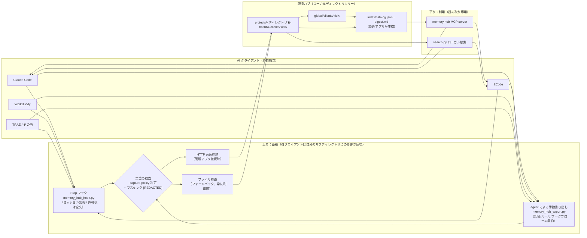
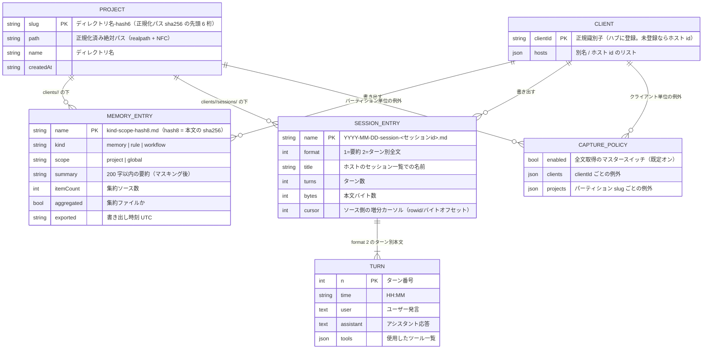

<p align="center">
  <a href="README.md">简体中文</a> ·
  <a href="README.zh-Hant.md">繁體中文</a> ·
  <a href="README.en.md">English</a> ·
  <a href="README.fr.md">Français</a> ·
  **日本語** ·
  <a href="README.ru.md">Русский</a>
</p>

# Memory Hub Plugin（クライアント間で記憶を共有するハブ）

複数の AI コーディングクライアントに**同じ記憶を共有させる**ローカルハブ。Claude Code で決めたアーキテクチャの約束、ZCode に記録した調査の結論、WorkBuddy でのセッションの成果——すべてがひとつのローカル記憶ストアに蓄積され、他のどのクライアントからでも検索・参照できます。

> **汎用・ローカル優先・デスクトップアプリに非依存。** Python 標準ライブラリのみで実装（サードパーティ依存ゼロ）。中身は「ひとつの Markdown ディレクトリツリー + 3 つの skill」というファイルプロトコルで、オンラインでもオフラインでも完全に動作します。任意の管理アプリ（コンパニオン）があれば集約インデックスと HTTP 高速経路が追加されますが、**なくても一切問題ありません**。

```text
Claude Code ─┐                                  ┌─> ZCode       「このプロジェクトの約束は？」
ZCode       ─┼─ 上り書き出し ─> ハブ ─ 下り検索 ─> Claude Code
WorkBuddy   ─┤   (集約・マスキング・増分)     └─> WorkBuddy
TRAE / ... ─┘      (読み取り専用)
```

## 3 つの skill

| Skill | 方向 | 役割 |
|---|---|---|
| `memory-hub-setup` | 接続セットアップ | ホストごとの**検証済み契約**に従って Stop フック / MCP 設定を書き込みます。冪等、書き込み前バックアップ（`*.hub-bak`）、ドライラン、読み戻し自己点検 |
| `memory-hub-export` | 上り（書き込み） | このクライアントの記憶 / ルール / ワークフロー / セッションをハブへ書き出します。集約、マスキング、内容ハッシュによる増分同期 |
| `memory-hub-consume` | 下り（読み取り） | 他クライアントが蓄積した記憶 / ルール / セッション要約をハブから検索します。**読み取り専用**。引用には必ずソースクライアントとパスを明記 |

対応ホスト（検証状況で階級分け、`setup.py --list` で一覧）：
Claude Code、ZCode、Codex、TRAE（国際版 / CN / SOLO）、WorkBuddy、Qoder、opencode、MiniMax Code。
未検証のホストやフック機構のないホストは、自動インストールを**明示的に拒否**し理由を示します（パスを推測しません）。手動エクスポート経路を使います。機能は同じで、自動でないだけです。

## 仕組み

### 記憶はどう共有されるか



3 つのコア設計制約：

1. **書き込みは分離、読み取りは共有**：各クライアントは自分の `clients/<id>/` サブディレクトリにのみ書き込め、他クライアントのデータには触れません。読み取りはクライアントを横断して検索できます。
2. **プロジェクトのパーティションはひとつ**：プロジェクト識別子は「realpath 正規化 + sha256 の先頭 6 桁」として一箇所でのみ計算されます（`skills/_shared/project_id.py`、リポジトリ内唯一の実装）。シンボリックリンク・大文字小文字・日本語ディレクトリ名があっても、同じプロジェクトが 2 つのパーティションに分裂することはありません。
3. **ファイルプロトコル優先**：ハブの実体は YAML frontmatter 付きの Markdown ディレクトリツリーで、人間でもスクリプトでも直接読めます。HTTP 高速経路は管理アプリ接続時の加速手段にすぎません。

### データ構造（ER）

ハブのディレクトリツリー（ルートは既定で `~/MemoryHub`、環境変数 `MEMORY_HUB_ROOT` で任意の場所へ変更可）：

```text
<記憶ルート>/
├── projects/<ディレクトリ名-hash6>/              # プロジェクトパーティション（slug は正規化パスのハッシュ）
│   ├── project.json                        # { path, name, createdAt }
│   └── clients/<clientId>/
│       ├── memory-project-<hash8>.md       # 記憶（集約ファイルには itemCount / aggregated を付与）
│       ├── rule-project-<hash8>.md         # ルール
│       ├── workflow-project-<hash8>.md     # ワークフロー
│       └── sessions/YYYY-MM-DD-session-<セッションid>.md   # セッション（要約 format 1 / 全文 format 2）
├── global/clients/<clientId>/              # グローバル記憶/ルール（プロジェクトに属さない）
│   └── memory-global-<hash8>.md
├── index/                                  # catalog.json（≤2KB のナビゲーション）+ digest.md（管理アプリ生成）
└── .state/                                 # client-ids.json · capture-policy.json · hook ログ
```

エンティティ関係：



すべての Markdown エントリは frontmatter（`client / scope / kind / project / summary / exported / itemCount / format / turns …`）を持ち、ファイル名がそのままインデックスになります。記憶/ルール/ワークフローのファイル名には本文ハッシュが入るため（同名＝同内容で、自然に増分・冪等）、セッションのファイル名には日付とセッション id が入ります。

## インストール

要件：Python 3.8+（標準ライブラリのみ）。**パッケージは丸ごと使う必要があります**——`skills/_shared/` と 3 つの skill ディレクトリは同じ親ディレクトリに置いてください（スクリプトは相対パスで互いを見つけます）。

### 方法 A：プラグインとしてインストール（agent-plugins 準拠クライアント / ZCode）

本リポジトリには `plugin.json`（agent-plugins.org 1.0.0 スキーマ）が同梱されています。この標準や ZCode プラグイン機構に対応したクライアントなら、このディレクトリをプラグインとして追加するだけで `skills/` が自動検出されます。

### 方法 B：素の skills パッケージ

```bash
# 1. 取得
git clone https://github.com/KKDestiny/memory-hub-plugin.git memory-hub-plugin

# 2. ホスト対応状況を確認（何も変更しません）
python3 memory-hub-plugin/skills/memory-hub-setup/scripts/setup.py --list

# 3. ドライラン：書き込まれるフック/MCP 内容をプレビュー
python3 memory-hub-plugin/skills/memory-hub-setup/scripts/setup.py --client claude-code --dry-run

# 4. 書き込み（書き込み前に *.hub-bak へ自動バックアップ。再実行は冪等）
python3 memory-hub-plugin/skills/memory-hub-setup/scripts/setup.py --client claude-code

# 5. 読み戻し点検：もう一度 --dry-run を実行し、written が空で修正残りがないことを確認
```

次に `skills/` 配下の 3 つのディレクトリを、お使いのホストの skill として登録します（ホストの規約に従ってコピーまたはシンボリックリンク）。ホスト再起動後、Stop フックがセッションの蓄積を自動で開始します。記憶/ルールの書き出しと検索は、各 SKILL.md の指示に従って agent が実行します。

**保存場所**：既定は `~/MemoryHub`。環境変数 `MEMORY_HUB_ROOT` で任意のディレクトリに変更できます。

## MCP Server サンプル
companion リポジトリ [memory-hub-examples](https://github.com/KKDestiny/memory-hub-examples) に、
依存ゼロの読み取り専用 MCP サーバー参考実装と、すぐ試せるサンプルデータを同梱しています。
管理アプリがなくても MCP 検索チャネルを通せます：

```json
{
  "mcpServers": {
    "memory-hub": {
      "command": "node",
      "args": ["/path/to/memory-hub-examples/mcp-server/memory-hub-mcp.mjs"],
      "env": { "MEMORY_HUB_ROOT": "/path/to/memory-hub-examples/example-hub" }
    }
  }
}
```

設定後、ホストから `search_hub` / `read_entry` / `hub_stats` の 3 ツールを呼び出せます。詳細は同リポジトリの README を参照してください。

## 他のクライアントを接続するには

新しいホストの接続 = アダプタテーブルに**検証済みの記録**を 1 件追加すること（`setup.py --list` が既存エントリの evidence フィールドを見本として表示します）：

| フィールド | 意味 |
|---|---|
| `hooks.file / shape / events / timeout` | フック設定ファイルの配置、構造の形（flat / zcode / trae）、対応イベント集合 |
| `hooks.input` | stdin 契約：`transcript_path` の有無、session_id / cwd のフィールド名 |
| `mcp.file / keys / serverExtra` | MCP 設定の配置とスキーマの厳格さ（未知キーでエントリ全体が破棄されるか） |
| `sessions / rules / memories` | 3 種データの平文の配置（書き出し/取り込みのソース） |
| `status / evidence` | 検証状況（verified-auto / verified-manual / unverified）と証拠ソース |

フック機構のないホスト（opencode など）は手動エクスポートを使います。agent がセッション終了時に `memory_hub_export.py` を呼び出すだけで、機能は同じ（自動でないだけ）。Python を実行でき、自分のセッションストレージを読めれば、どのホストでも手動モードで完全に接続できます。

## 典型的なユースケース

**① ツール間の引き継ぎ**：月曜に Claude Code でチームと「このプロジェクトの ORM は Drizzle 一択」と決めてルールに書き込む。水曜に ZCode で「このプロジェクトの ORM の約束は？」と聞くと、`memory-hub-consume` がハブ内の Claude Code が書き出したルールファイルを検出し、出典付き（`claude-code · projects/<slug>/clients/claude-code/rule-project-9f3e2a1b.md`）で回答します。

**② セッションの自動蓄積**：普段は何もしません。各クライアントの Stop フックがセッションごとの要約（許可後はターン別全文）をハブの対応プロジェクトパーティションへ自動書き込みします。1 か月後の「先月の同期競合でどんな手法を試したっけ？」がそのまま検索できます。

**③ 履歴の一括移行**：新しいマシンや新規クライアントの接続時に、agent に「過去のセッションを全部ハブに取り込んで」と伝えるだけ。`--import-all` はまずドライランで「N 件を取り込みます」と報告し、確認後に全量を増分取り込みします。再実行しても重複登録されません。

**④ 複数ツール × 同一プロジェクト**：昼は WorkBuddy、夜は ZCode で同じリポジトリを触る——両者のセッションと記憶は正規化パスに基づいて**同じ** `projects/<slug>/` パーティション内のそれぞれの `clients/` サブディレクトリに格納され、検索では両側が見えるため「同じプロジェクトなのに記憶が 2 つに割れる」ことはありません。

## セキュリティとプライバシー

- **マスキング**：書き出し前に本文と要約へパターンベースのマスキングを適用します（`sk-…`/`ghp_…`/`xox…` 形式のトークン、`api_key=…` のキー・バリュー、48 文字以上の長いランダム文字列 → `[REDACTED]`）。これは**補助策であり機密分類ではありません**。非 ASCII のキー名などは見逃す可能性があるため、唯一の防線とは考えないでください。機密情報はセッションに入れないでください。
- **許可チェック**：セッション**全文**の取得は `.state/capture-policy.json` で制御されます（マスタースイッチ / クライアント別 / パーティション別の 3 段階の例外）。未許可なら自動的に要約レベルへフォールバックします。チェックはクライアント側と取り込み側でそれぞれ 1 回実行されます。
- **信頼モデル**：ハブはローカルの平文ディレクトリで、マシン上の全プロセスから読めます。あなたがそのマシンの唯一のユーザーであることを前提としています。共用マシンでは使わないでください。ハブルートへの `chmod 700` を推奨します。詳細は [SECURITY.md](SECURITY.md)。

## 既知の制限

- ZCode / Codex など一部ホストのセッション読み取りは、その**プライベートストレージのリバースエンジニアリング済みスキーマ**に依存します。ホストの大型アップデートで壊れる可能性がありますが、その場合は要約レベルへ自動縮退し、エラーで停止することはありません。
- 記憶エントリは「プロジェクト + 種別 + 本文ハッシュ」でキー管理されるため、同一プロジェクト・同種別の非集約シャードは互いに上書きします。SKILL.md の規約に従い、集約モードで書き出してください。
- 検索は線形の全文走査で、数百エントリ程度まで快適です。それ以上はインデックスが必要です（管理アプリ側の集約で担えます）。

## コントリビュート

コミットメッセージとコードコメントの規約は [CONTRIBUTING.md](CONTRIBUTING.md)、セキュリティ問題の報告方法と信頼モデルは [SECURITY.md](SECURITY.md)、変更履歴は [CHANGELOG.md](CHANGELOG.md) を参照してください。

## ライセンス

MIT — 詳細は [LICENSE](LICENSE)。
