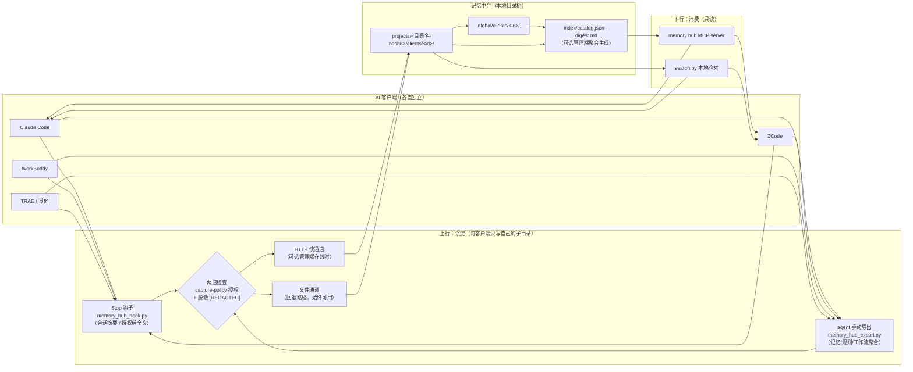
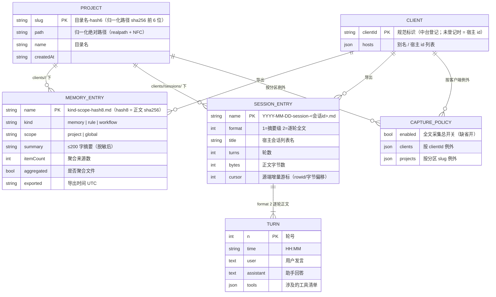

# Memory Hub Plugin（跨客户端共享记忆中台）

让多个 AI 编码客户端**共享同一份记忆**的本地中台：你在 Claude Code 里定下的架构约定、在 ZCode 里记录的问题排查结论、在 WorkBuddy 里聊过的会话结论，都会沉淀到同一个本地记忆库，并能在任意其他客户端里检索引用。

> **通用、本地优先、不绑定任何桌面应用。** 纯 Python 标准库实现（零第三方依赖），核心是「一个 Markdown 目录树 + 三个 skill」的文件协议——不联网、不依赖任何在线服务即可完整工作；若有配套管理端，可获得聚合索引与 HTTP 快通道，但**没有它一切照常**。

```text
Claude Code ─┐                                  ┌─> ZCode       「这个项目之前怎么约定的？」
ZCode       ─┼─ 上行导出 ─> 记忆中台目录 ─ 下行检索 ─> Claude Code
WorkBuddy   ─┤   (聚合·脱敏·增量)     (只读)     └─> WorkBuddy
TRAE / ... ─┘
```

## 三个 Skill

| Skill | 方向 | 作用 |
|---|---|---|
| `memory-hub-setup` | 接入装配 | 按各宿主**真实契约**把 Stop 钩子 / MCP 写进配置。幂等、写前备份（`*.hub-bak`）、干跑预览、回读自检 |
| `memory-hub-export` | 上行（写） | 把本客户端的记忆 / 规则 / 工作流 / 会话导出到中台。聚合、脱敏、内容 hash 增量 |
| `memory-hub-consume` | 下行（读） | 从中台检索其他客户端沉淀的记忆 / 规则 / 会话摘要。**只读**，引用必须标注来源客户端与路径 |

已适配宿主（按取证状态分级，`setup.py --list` 可查看）：
Claude Code、ZCode、Codex、TRAE（国际版 / CN / SOLO）、WorkBuddy、Qoder、opencode、MiniMax Code。
未取证或无钩子机制的宿主会**明确拒绝**自动安装并给出原因，不猜测路径；它们走「手动导出」通道，功能等价、只是不自动。

## 工作原理

### 记忆如何被共享



三条核心设计约束：

1. **写隔离，读共享**：每个客户端只允许写 `clients/<自己的id>/` 子目录，绝不碰其他客户端的数据；读则可以跨客户端检索。
2. **同一项目只有一个分区**：项目标识由「realpath 归一化 + sha256 前 6 位」统一计算（实现位于 `skills/_shared/project_id.py`，全仓库仅此一处），符号链接、大小写、中文目录名都不会使同一项目被拆分为两个分区。
3. **文件协议优先**：中台就是一个 Markdown 目录树（带 YAML frontmatter），任何工具（包括人和其他脚本）都能直接读；HTTP 快通道只是可选管理端在线时的加速路径。

### 数据结构（ER）

中台目录树（根目录默认 `~/DutiMemory`，可用 `MEMORY_HUB_ROOT` 环境变量指向任意位置）：

```text
<记忆根目录>/
├── projects/<目录名-hash6>/              # 项目分区（slug 由归一化路径 hash 而来）
│   ├── project.json                      # { path, name, createdAt }
│   └── clients/<clientId>/
│       ├── memory-project-<hash8>.md     # 记忆（聚合文件带 itemCount / aggregated）
│       ├── rule-project-<hash8>.md       # 规则
│       ├── workflow-project-<hash8>.md   # 工作流
│       └── sessions/YYYY-MM-DD-session-<会话id>.md   # 会话（摘要 format 1 / 全文 format 2）
├── global/clients/<clientId>/            # 全局记忆/规则（无项目归属）
│   └── memory-global-<hash8>.md
├── index/                                # catalog.json（≤2KB 导航）+ digest.md（可选管理端生成）
└── .state/                               # client-ids.json · capture-policy.json · hook 日志
```

实体关系：



每个 Markdown 条目自带 frontmatter（`client / scope / kind / project / summary / exported / itemCount / format / turns …`），文件名即索引：记忆/规则/工作流的文件名含正文 hash（同名即同内容，天然增量幂等），会话文件名含日期与会话 id。

## 安装

依赖：Python 3.8+（仅标准库）。**必须整包使用**——`skills/_shared/` 与三个 skill 目录必须保持同父目录（脚本按相对路径互找）。

### 方式 A：作为插件安装（agent-plugins 标准客户端 / ZCode）

本仓库带 `plugin.json`（agent-plugins.org 1.0.0 schema）。支持该标准或 ZCode 插件体系的客户端，直接把本目录作为插件添加即可，`skills/` 会被自动发现。

### 方式 B：裸 skills 整包

```bash
# 1. 获取
git clone https://github.com/KKDestiny/memory-hub-plugin.git memory-hub-plugin

# 2. 查看宿主适配状态（不改任何东西）
python3 memory-hub-plugin/skills/memory-hub-setup/scripts/setup.py --list

# 3. 干跑：预览将写入的钩子/MCP 内容
python3 memory-hub-plugin/skills/memory-hub-setup/scripts/setup.py --client claude-code --dry-run

# 4. 落盘（写前自动备份 *.hub-bak；重复执行幂等）
python3 memory-hub-plugin/skills/memory-hub-setup/scripts/setup.py --client claude-code

# 5. 回读自检：再跑一次 --dry-run，确认 written 为空、无待校正项
```

然后把 `skills/` 下三个目录注册为你宿主的 skill（按各宿主的 skills 目录约定复制或软链）。重启宿主后，Stop 钩子即开始自动沉淀会话；记忆/规则的导出与检索由 agent 按各 SKILL.md 的指令执行。

**存储位置**：默认为 `~/DutiMemory`；设置环境变量 `MEMORY_HUB_ROOT` 可指向任意目录。

## 其他客户端如何接入

新宿主接入 = 在适配表中补一条**取证记录**（`setup.py --list` 会展示现有条目的 evidence 字段作为范例）：

| 字段 | 含义 |
|---|---|
| `hooks.file / shape / events / timeout` | 钩子配置文件落点、结构形态（flat / zcode / trae）、支持的事件集合 |
| `hooks.input` | stdin 契约：有无 `transcript_path`、session_id / cwd 字段名 |
| `mcp.file / keys / serverExtra` | MCP 配置落点与 schema 严格度（未知键会不会被整条丢弃） |
| `sessions / rules / memories` | 三类数据的明文落点（导出/导入的来源） |
| `status / evidence` | 取证状态（verified-auto / verified-manual / unverified）与证据来源 |

没有钩子机制的宿主（如 opencode）走手动导出：agent 在会话结束时主动调用 `memory_hub_export.py`，功能等价、只是不自动。任何宿主只要能跑 Python 并能读自己的会话存储，就至少能用手动模式完整接入。

## 典型场景

**① 跨工具接力**：周一在 Claude Code 里和团队定了「本项目 ORM 一律用 Drizzle」并写入其规则；周三在 ZCode 里问「这个项目的 ORM 约定是什么」——`memory-hub-consume` 检索命中中台里 Claude Code 导出的规则文件，回答自动标注来源（`claude-code · projects/<slug>/clients/claude-code/rule-project-9f3e2a1b.md`）。

**② 会话自动沉淀**：日常使用无需额外操作。客户端 Stop 钩子把每场会话的摘要（授权后是逐轮全文）自动写进中台对应项目分区；一个月后「上个月调同步冲突时试过哪些方案」即可直接检索到。

**③ 历史迁移**：新装一台机器或新接入一个客户端，对 agent 说「把历史会话全部导入记忆中台」——`--import-all` 先 dry-run 报告「将导入 N 场」，确认后全量增量导入，重复执行不会重复入库。

**④ 多工具同一项目**：白天用 WorkBuddy、晚上用 ZCode 改同一个仓库——两者的会话与记忆按归一化路径落到**同一个** `projects/<slug>/` 分区下各自的 `clients/` 子目录，检索时两侧沉淀互相可见，不会出现「同一项目两份记忆」。

## 安全与隐私

- **脱敏**：导出前对正文与摘要执行模式脱敏（`sk-…`/`ghp_…`/`xox…` 类 token、`api_key=…` 键值对、≥48 位长随机串 → `[REDACTED]`）。注意这是**辅助措施而非机密分级**：中文键名等场景可能漏报，不应将其作为唯一防线，敏感内容请勿放入会话。
- **授权检查**：会话**全文**采集受 `.state/capture-policy.json` 控制（总开关 / 按客户端 / 按项目分区三级例外），未授权时自动回退为摘要级；客户端与入库侧各执行一次检查。
- **信任模型**：中台是本地明文目录，对本机所有进程可读——它假设你是这台机器唯一的使用者。多人共用的机器请勿使用，建议对中台根目录执行 `chmod 700`。详见 [SECURITY.md](SECURITY.md)。

## 已知限制

- ZCode / Codex 等宿主的会话读取依赖其**私有存储的逆向 schema**，宿主大版本升级后可能失效（失效时自动退化为摘要级，不会报错炸掉）。
- 记忆条目按「项目 + 类型 + 正文 hash」键控：同项目同类型的多个非聚合分片会相互覆盖——请按 SKILL.md 的约定执行聚合导出。
- 检索为线性全文扫描，条目在数百个量级内体验良好；更大规模需要索引（可由管理端聚合承担）。

## 参与贡献

提交信息与代码注释的书写规范见 [CONTRIBUTING.md](CONTRIBUTING.md)；安全问题的报告方式与信任模型见 [SECURITY.md](SECURITY.md)；变更历史见 [CHANGELOG.md](CHANGELOG.md)。

## License

MIT，详见 [LICENSE](LICENSE)。
