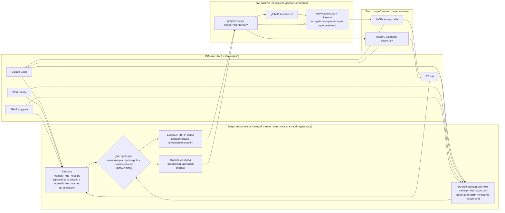
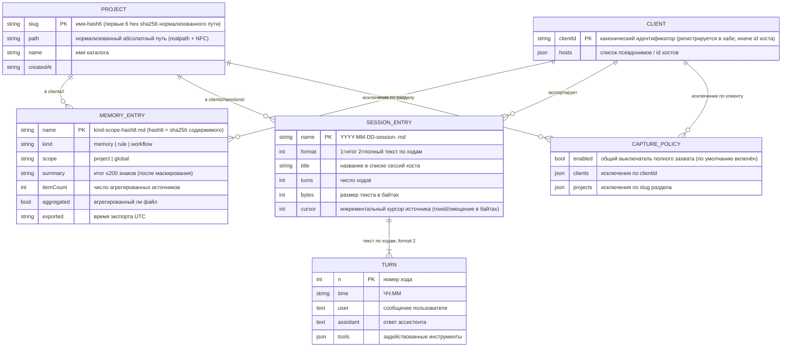

<p align="center">
  <a href="README.md">简体中文</a> ·
  <a href="README.zh-Hant.md">繁體中文</a> ·
  <a href="README.en.md">English</a> ·
  <a href="README.fr.md">Français</a> ·
  <a href="README.ja.md">日本語</a> ·
  **Русский**
</p>

# Memory Hub Plugin (хаб общей памяти для разных клиентов)

Локальный хаб, позволяющий нескольким ИИ-клиентам для кодинга **использовать общую память**: архитектурные договорённости, зафиксированные в Claude Code, выводы по отладке, записанные в ZCode, итоги сессий из WorkBuddy — всё это оседает в одном локальном хранилище памяти, доступном для поиска и цитирования из любого другого клиента.

> **Универсальный, локальный, не привязан к настольному приложению.** Реализован только на стандартной библиотеке Python (ноль сторонних зависимостей); ядро — файловый протокол «одно дерево каталогов Markdown + три skill». Полностью работает без сети и без каких-либо онлайн-сервисов. С опциональным управляющим приложением дополнительно доступны агрегированные индексы и быстрый HTTP-канал, но **без него всё работает как обычно**.

```text
Claude Code ─┐                                    ┌─> ZCode        «Какие договорённости по этому проекту?»
ZCode       ─┼─ экспорт ─> Каталог хаба ─ поиск ─> Claude Code
WorkBuddy   ─┤   (агрегация · маскирование · инкремент) └─> WorkBuddy
TRAE / ... ─┘                   (только чтение)
```

## Три skill

| Skill | Направление | Назначение |
|---|---|---|
| `memory-hub-setup` | Подключение | Записывает Stop-хук / конфигурацию MCP в настройки хостов согласно их **проверенному контракту**. Идемпотентно, с резервной копией перед записью (`*.hub-bak`), пробным прогоном и самопроверкой перечитыванием |
| `memory-hub-export` | Вверх (запись) | Экспортирует память / правила / рабочие процессы / сессии этого клиента в хаб. Агрегация, маскирование, инкрементальная синхронизация по хешу содержимого |
| `memory-hub-consume` | Вниз (чтение) | Ищет в хабе память / правила / краткие итоги сессий, накопленные другими клиентами. **Только чтение**; при цитировании обязательно указывать клиента-источник и путь |

Поддерживаемые хосты (классифицированы по статусу проверки; см. `setup.py --list`):
Claude Code, ZCode, Codex, TRAE (International / CN / SOLO), WorkBuddy, Qoder, opencode, MiniMax Code.
Непроверенные хосты и хосты без механизма хуков **явно отказывают** в автоматической установке и объясняют причину — пути не угадываются. Для них предусмотрен канал ручного экспорта: функционально то же самое, просто без автоматики.

## Как это работает

### Как память становится общей



Три ключевых проектных ограничения:

1. **Изолированная запись, общее чтение**: каждый клиент может писать только в свой подкаталог `clients/<id>/` и не касается данных других клиентов; чтение доступно по всем клиентам.
2. **Один раздел на проект**: идентификатор проекта вычисляется единственным способом — «нормализация realpath + первые 6 hex-символов sha256» (реализация в `skills/_shared/project_id.py`, единственная в репозитории). Символические ссылки, регистр букв и не-ASCII имена каталогов никогда не разбивают один проект на два раздела.
3. **Файловый протокол прежде всего**: хаб — это просто дерево каталогов Markdown (с YAML frontmatter), которое любой инструмент — включая человека и другие скрипты — читает напрямую. Быстрый HTTP-канал лишь ускоряет работу, когда управляющее приложение онлайн.

### Структура данных (ER)

Дерево каталогов хаба (корень по умолчанию `~/MemoryHub`; переменная окружения `MEMORY_HUB_ROOT` позволяет указать любой путь):

```text
<корень памяти>/
├── projects/<имя-hash6>/              # раздел проекта (slug — из хеша нормализованного пути)
│   ├── project.json                   # { path, name, createdAt }
│   └── clients/<clientId>/
│       ├── memory-project-<hash8>.md  # память (агрегированные файлы несут itemCount / aggregated)
│       ├── rule-project-<hash8>.md    # правило
│       ├── workflow-project-<hash8>.md # рабочий процесс
│       └── sessions/YYYY-MM-DD-session-<id сессии>.md   # сессия (итог format 1 / полный текст format 2)
├── global/clients/<clientId>/         # глобальная память/правила (без привязки к проекту)
│   └── memory-global-<hash8>.md
├── index/                             # catalog.json (навигация ≤2КБ) + digest.md (управляющее приложение)
└── .state/                            # client-ids.json · capture-policy.json · журналы хуков
```

Связи сущностей:



Каждая Markdown-запись несёт frontmatter (`client / scope / kind / project / summary / exported / itemCount / format / turns …`); имя файла само является индексом: имена памяти/правил/процессов содержат хеш содержимого (то же имя = то же содержимое — естественная инкрементальность и идемпотентность), имена сессий — дату и идентификатор сессии.

## Установка

Требуется Python 3.8+ (только стандартная библиотека). **Пакет используется целиком** — `skills/_shared/` и три каталога skill должны находиться в одном родительском каталоге (скрипты находят друг друга по относительным путям).

### Вариант A: установка как плагина (клиенты со стандартом agent-plugins / ZCode)

В репозитории есть `plugin.json` (схема agent-plugins.org 1.0.0). Клиенты, поддерживающие этот стандарт или систему плагинов ZCode, могут добавить каталог как плагин напрямую; `skills/` обнаруживается автоматически.

### Вариант B: базовый пакет skills

```bash
# 1. Получить
git clone https://github.com/KKDestiny/memory-hub-plugin.git memory-hub-plugin

# 2. Посмотреть статус адаптации хостов (ничего не меняет)
python3 memory-hub-plugin/skills/memory-hub-setup/scripts/setup.py --list

# 3. Пробный прогон: предпросмотр содержимого хуков/MCP, которое будет записано
python3 memory-hub-plugin/skills/memory-hub-setup/scripts/setup.py --client claude-code --dry-run

# 4. Записать (автоматическая резервная копия *.hub-bak перед записью; повторный запуск идемпотентен)
python3 memory-hub-plugin/skills/memory-hub-setup/scripts/setup.py --client claude-code

# 5. Самопроверка: снова --dry-run; written должен быть пуст, нечего исправлять
```

Затем зарегистрируйте три каталога внутри `skills/` как skill вашего хоста (скопируйте или создайте символические ссылки согласно правилам хоста). После перезапуска хоста Stop-хук начнёт автоматически накапливать сессии; экспорт и поиск памяти/правил агент выполняет по инструкциям каждого SKILL.md.

**Расположение хранилища**: по умолчанию `~/MemoryHub`; переменная окружения `MEMORY_HUB_ROOT` указывает на любой каталог.

## Пример MCP-сервера
Сопутствующий репозиторий [memory-hub-examples](https://github.com/KKDestiny/memory-hub-examples)
содержит эталонную реализацию только читающего MCP-сервера без зависимостей и готовый демонстрационный
хаб — MCP-канал поиска работает без управляющего приложения:

```json
{
  "mcpServers": {
    "memory-hub": {
      "command": "node",
      "args": ["/path/to/memory-hub-examples/mcp-server/memory-hub-mcp.mjs"],
      "env": { "MEMORY_HUB_ROOT": "/path/to/memory-hub-examples/example-hub" }
    }
  }
}
```

После настройки хост может вызывать инструменты `search_hub` / `read_entry` / `hub_stats` — подробности
в README того репозитория.

## Как подключить другой клиент

Подключение нового хоста = добавление одной **проверенной записи** в таблицу адаптации (`setup.py --list` показывает поля evidence существующих записей как образец):

| Поле | Значение |
|---|---|
| `hooks.file / shape / events / timeout` | Расположение файла настроек хуков, форма структуры (flat / zcode / trae), набор поддерживаемых событий |
| `hooks.input` | Контракт stdin: наличие `transcript_path`, имена полей session_id / cwd |
| `mcp.file / keys / serverExtra` | Расположение конфигурации MCP и строгость схемы (отбрасывает ли неизвестные ключи запись целиком) |
| `sessions / rules / memories` | Расположение трёх классов данных в открытом виде (источники экспорта/импорта) |
| `status / evidence` | Статус проверки (verified-auto / verified-manual / unverified) и источник доказательств |

Хосты без механизма хуков (например, opencode) используют ручной экспорт: агент сам вызывает `memory_hub_export.py` в конце сессии — функционально то же, просто без автоматики. Любой хост, способный запустить Python и прочитать собственное хранилище сессий, может полностью подключиться в ручном режиме.

## Типичные сценарии

**① Эстафета между инструментами**: в понедельник вы договорились с командой в Claude Code, что «ORM этого проекта — всегда Drizzle», и это стало правилом; в среду вы спрашиваете ZCode «какие договорённости по ORM в этом проекте?» — `memory-hub-consume` находит в хабе файл правил, экспортированный Claude Code, и ответ автоматически ссылается на источник (`claude-code · projects/<slug>/clients/claude-code/rule-project-9f3e2a1b.md`).

**② Автоматическое накопление сессий**: в повседневной работе ничего делать не нужно. Stop-хук каждого клиента записывает краткий итог каждой сессии (полный текст по ходам после авторизации) в соответствующий раздел проекта хаба; через месяц запрос «какие подходы мы пробовали для того конфликта синхронизации?» сразу находит ответ.

**③ Перенос истории**: на новой машине или для нового клиента скажите агенту «импортируй все исторические сессии в хаб памяти» — `--import-all` сначала выполнит пробный прогон и сообщит «будет импортировано N сессий»; после подтверждения импортирует всё инкрементально, и повторный запуск никогда не создаёт дубликатов.

**④ Несколько инструментов, один проект**: днём вы правите репозиторий в WorkBuddy, вечером — в ZCode; сессии и память обоих инструментов попадают в **один и тот же** раздел `projects/<slug>/`, каждый в свой подкаталог `clients/` (ключи — по нормализованному пути). При поиске видны обе стороны, и у одного проекта никогда не появляется две расходящиеся памяти.

## Безопасность и приватность

- **Маскирование**: перед экспортом текст и итог проходят маскирование по шаблонам (токены вида `sk-…`/`ghp_…`/`xox…`, пары `api_key=…`, случайные строки ≥48 символов → `[REDACTED]`). Это **вспомогательная мера, а не классификация секретов**: например, не-ASCII имена ключей могут быть пропущены; не считайте её единственной линией обороны и не помещайте чувствительные данные в сессии.
- **Проверка авторизации**: полный захват сессий управляется файлом `.state/capture-policy.json` (общий выключатель / исключения по клиенту / по разделу); без авторизации — автоматический откат к уровню итогов. Проверка выполняется один раз на стороне клиента и один раз при приёме данных.
- **Модель доверия**: хаб — локальный каталог в открытом виде, читаемый всеми процессами машины; предполагается, что вы единственный пользователь этого компьютера. Не используйте его на общих машинах; рекомендуется `chmod 700` для корня хаба. См. [SECURITY.md](SECURITY.md).

## Известные ограничения

- Чтение сессий таких хостов, как ZCode / Codex, зависит от **реверс-инжиниринга схемы их приватного хранилища**; крупное обновление хоста может его сломать (при сбое происходит откат к уровню итогов, без аварийного завершения).
- Записи памяти индексируются по «проект + тип + хеш содержимого»: несколько неагрегированных осколков одного проекта и типа перезаписывают друг друга — следуйте правилам SKILL.md и экспортируйте в агрегированном режиме.
- Поиск — линейный сплошной скан; удобен до нескольких сотен записей. Для больших объёмов нужен индекс (его может создавать управляющее приложение).

## Участие в разработке

Правила коммитов и комментариев к коду: [CONTRIBUTING.md](CONTRIBUTING.md); сообщение об уязвимостях и модель доверия: [SECURITY.md](SECURITY.md); история изменений: [CHANGELOG.md](CHANGELOG.md).

## Лицензия

MIT — см. [LICENSE](LICENSE).
