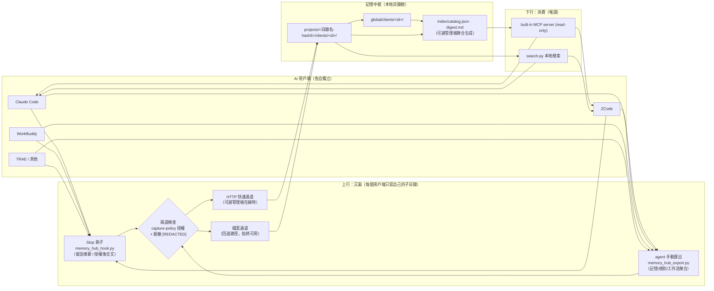
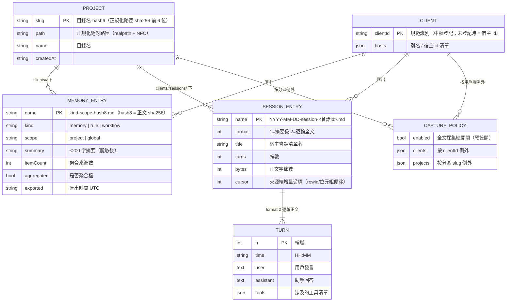

<p align="center">
  <a href="README.md">简体中文</a> ·
  **繁體中文** ·
  <a href="README.en.md">English</a> ·
  <a href="README.fr.md">Français</a> ·
  <a href="README.ja.md">日本語</a> ·
  <a href="README.ru.md">Русский</a>
</p>

# Memory Hub Plugin（跨用戶端共享記憶中樞）

讓多個 AI 編碼用戶端**共享同一份記憶**的本地中樞：你在 Claude Code 裡定下的架構約定、在 ZCode 裡記錄的問題排查結論、在 WorkBuddy 裡聊過的會話結論，都會沉澱到同一個本地記憶庫，並能在任意其他用戶端裡檢索引用。

> **通用、本地優先、不綁定任何桌面應用。** 純 Python 標準庫實作（零第三方依賴），核心是「一個 Markdown 目錄樹 + 三個 skill + 內建唯讀 MCP server」的檔案協定——不連網、不依賴任何線上服務即可完整運作；若有配套管理端，可獲得聚合索引與 HTTP 快速通道，但**沒有它一切照常**。

```text
Claude Code ─┐                                     ┌─> ZCode       「這個專案之前怎麼約定的？」
ZCode       ─┼─ 上行匯出 ─> 記憶中樞目錄 ─ 下行檢索 ─> Claude Code
WorkBuddy   ─┤   (聚合·脫敏·增量)     (唯讀)     └─> WorkBuddy
TRAE / ... ─┘
```

## 產品組成

| Skill | 方向 | 作用 |
|---|---|---|
| `memory-hub-setup` | 接入裝配 | 按各宿主**真實契約**把 Stop 鉤子 / MCP 寫進設定。冪等、寫前備份（`*.hub-bak`）、乾跑預覽、回讀自檢 |
| `memory-hub-export` | 上行（寫） | 把本用戶端的記憶 / 規則 / 工作流 / 會話匯出到中樞。聚合、脫敏、內容 hash 增量 |
| `memory-hub-consume` | 下行（讀） | 從中樞檢索其他用戶端沉澱的記憶 / 規則 / 會話摘要。**唯讀**，引用必須標註來源用戶端與路徑 |

除 skills 外，倉庫還包含兩個產品元件：

- `mcp/` —— 內建唯讀 MCP server（7 個工具）：任何支援 MCP 的用戶端**無需安裝 skill** 即可檢索中樞，見下文「MCP Server（內建）」；
- `examples/hub/` —— 可直接體驗的迷你中樞資料，同時是檢索一致性的測試基線。

已適配宿主（按取證狀態分級，`setup.py --list` 可查看）：
Claude Code、ZCode、Codex、TRAE（國際版 / CN / SOLO）、WorkBuddy、Qoder、opencode、MiniMax Code。
未取證或無鉤子機制的宿主會**明確拒絕**自動安裝並給出原因，不猜測路徑；它們走「手動匯出」通道，功能等價、只是不自動。

## 運作原理

### 記憶如何被共享



三條核心設計約束：

1. **寫隔離，讀共享**：每個用戶端只允許寫 `clients/<自己的id>/` 子目錄，絕不碰其他用戶端的資料；讀則可以跨用戶端檢索。
2. **同一專案只有一個分區**：專案識別由「realpath 正規化 + sha256 前 6 位」統一計算（實作位於 `skills/_shared/project_id.py`，全倉庫僅此一處），符號連結、大小寫、中文目錄名都不會使同一專案被拆分為兩個分區。
3. **檔案協定優先**：中樞就是一個 Markdown 目錄樹（帶 YAML frontmatter），任何工具（包括人和其他腳本）都能直接讀；HTTP 快速通道只是可選管理端在線時的加速路徑。

### 資料結構（ER）

中樞目錄樹（根目錄預設 `~/MemoryHub`，可用 `MEMORY_HUB_ROOT` 環境變數指向任意位置）：

```text
<記憶根目錄>/
├── projects/<目錄名-hash6>/              # 專案分區（slug 由正規化路徑 hash 而來）
│   ├── project.json                      # { path, name, createdAt }
│   └── clients/<clientId>/
│       ├── memory-project-<hash8>.md     # 記憶（聚合檔帶 itemCount / aggregated）
│       ├── rule-project-<hash8>.md       # 規則
│       ├── workflow-project-<hash8>.md   # 工作流
│       └── sessions/YYYY-MM-DD-session-<會話id>.md   # 會話（摘要 format 1 / 全文 format 2）
├── global/clients/<clientId>/            # 全域記憶/規則（無專案歸屬）
│   └── memory-global-<hash8>.md
├── index/                                # catalog.json（≤2KB 導航）+ digest.md（可選管理端生成）
└── .state/                               # client-ids.json · capture-policy.json · hook 日誌
```

實體關係：



每個 Markdown 條目自帶 frontmatter（`client / scope / kind / project / summary / exported / itemCount / format / turns …`），檔名即索引：記憶/規則/工作流的檔名含正文 hash（同名即同內容，天然增量冪等），會話檔名含日期與會話 id。

## 安裝

依賴：Python 3.8+（僅標準庫）。**必須整包使用**——`skills/_shared/` 與三個 skill 目錄必須保持同父目錄（腳本按相對路徑互找）。

### 方式 A：作為外掛安裝（agent-plugins 標準用戶端 / ZCode）

本倉庫帶 `plugin.json`（agent-plugins.org 1.0.0 schema）。支援該標準或 ZCode 外掛體系的用戶端，直接把本目錄作為外掛加入即可，`skills/` 會被自動發現。

### 方式 B：裸 skills 整包

```bash
# 1. 取得
git clone https://github.com/KKDestiny/memory-hub-plugin.git memory-hub-plugin

# 2. 查看宿主適配狀態（不改动任何東西）
python3 memory-hub-plugin/skills/memory-hub-setup/scripts/setup.py --list

# 3. 乾跑：預覽將寫入的鉤子/MCP 內容
python3 memory-hub-plugin/skills/memory-hub-setup/scripts/setup.py --client claude-code --dry-run

# 4. 寫入（寫前自動備份 *.hub-bak；重複執行冪等）
python3 memory-hub-plugin/skills/memory-hub-setup/scripts/setup.py --client claude-code

# 5. 回讀自檢：再跑一次 --dry-run，確認 written 為空、無待校正項
```

然後把 `skills/` 下三個目錄註冊為你宿主的 skill（按各宿主的 skills 目錄約定複製或軟連結）。重啟宿主後，Stop 鉤子即開始自動沉澱會話；記憶/規則的匯出與檢索由 agent 按各 SKILL.md 的指令執行。

**儲存位置**：預設為 `~/MemoryHub`；設定環境變數 `MEMORY_HUB_ROOT` 可指向任意目錄。

## MCP Server（內建）

本倉庫自帶唯讀 MCP server（`mcp/memory-hub-mcp.mjs`，零依賴 Node 18+）：**任何支援 MCP 的用戶端無需安裝本外掛的 skill 即可檢索中樞**；寫入仍由 export skill 負責，server 不提供任何寫入工具。

```json
{
  "mcpServers": {
    "memory-hub": {
      "type": "stdio",
      "command": "node",
      "args": ["/path/to/memory-hub-plugin/mcp/memory-hub-mcp.mjs"],
      "env": { "MEMORY_HUB_ROOT": "/Users/you/MemoryHub" }
    }
  }
}
```

- **零設定**：支援 agent-plugins 標準的用戶端經倉庫根 `mcp.json` 自動發現，裝外掛即得；
- **腳本接入**：`setup.py --client <id>` 預設寫入上表條目（`--mcp-source desktop` 可切換為執務Studio 完整 server：授權寫、聚合索引）；
- **工具**：`search_hub` / `read_entry` / `get_session` / `list_partitions` / `list_clients` / `read_catalog` / `hub_stats`（全部唯讀），詳見 [mcp/README.md](mcp/README.md)；
- 想先用範例資料體驗：把 `MEMORY_HUB_ROOT` 指向本倉庫 [examples/hub](examples/)。

## 使用情境（以具體用戶端為例）

各宿主能力不同，接入後的形態分兩類：**自動宿主**（ZCode、Claude Code、WorkBuddy、Qoder——Stop 鉤子可自動沉澱會話）與 **MCP 宿主**（Codex、MiniMax Code、opencode、TRAE 系列——鉤子不可用或無轉錄：讀走 MCP，寫走手動匯出）。

### ZCode：全功能形態（自動沉澱 + MCP 直讀）

```bash
# 1. 一條命令接入：寫入 Stop 鉤子 + 內建唯讀 MCP server（寫前備份，可重複執行）
python3 skills/memory-hub-setup/scripts/setup.py --client zcode
# 2. 重啟 ZCode 生效
```

之後**日常無需任何操作**：每場會話結束時 Stop 鉤子自動把摘要（授權後為逐輪全文）寫入中樞對應的專案分區。在 ZCode 對話裡問「這個專案之前是怎麼約定的？」，模型直接呼叫 `search_hub` 檢索並以來源引用作答；未設定 MCP 時，agent 也會按 consume skill 跑檢索腳本——兩條讀取路徑等價。記憶/規則/工作流在會話裡對 agent 說「匯出到記憶中樞」即可，由 export skill 聚合寫入。

### Codex：MCP 宿主形態（讀走 MCP，寫走手動）

Codex 的鉤子結構未取證，接入腳本只寫 MCP（TOML 格式）：

```bash
python3 skills/memory-hub-setup/scripts/setup.py --client codex --mcp-only   # 寫入 ~/.codex/config.toml
```

重啟 Codex 後即可在對話中檢索中樞（`search_hub` 等工具）。寫入沒有自動通道，走兩條手動路徑：

```bash
# 記憶/規則聚合匯出（agent 也可按 export skill 執行）
python3 skills/memory-hub-export/scripts/memory_hub_export.py --client codex --kind memory --from-dir <目錄> --project <專案絕對路徑>
# 歷史會話全量匯入：先 dry-run 清點「將匯入 N 場」，確認後去掉 --dry-run（Codex 的明文會話目錄以實際為準）
python3 skills/memory-hub-export/scripts/memory_hub_hook.py --client codex --import-all --sessions-dir <你的明文會話目錄> --dry-run
```

MiniMax Code、opencode、TRAE 系列同屬這一形態。

### Claude Code → ZCode：跨用戶端接力

週一在 Claude Code 裡和團隊定下「本專案 ORM 一律用 Drizzle」並寫入其規則，鉤子同時自動沉澱當天的會話；週三在 ZCode 裡問「這個專案的 ORM 約定是什麼」——`search_hub` 命中中樞裡 claude-code 匯出的規則檔，回答自動標註來源（`claude-code · projects/<分區>/clients/claude-code/rule-project-<hash>.md`）。兩個用戶端改的是同一個倉庫：各自的沉澱落在同一分區的不同 `clients/` 子目錄，檢索互相可見。

## 其他用戶端如何接入

新宿主接入 = 在適配表中補一條**取證記錄**（`setup.py --list` 會展示現有條目的 evidence 欄位作為範例）：

| 欄位 | 含義 |
|---|---|
| `hooks.file / shape / events / timeout` | 鉤子設定檔落點、結構形態（flat / zcode / trae）、支援的事件集合 |
| `hooks.input` | stdin 契約：有無 `transcript_path`、session_id / cwd 欄位名 |
| `mcp.file / keys / serverExtra` | MCP 設定落點與 schema 嚴格度（未知鍵會不會被整條丟棄） |
| `sessions / rules / memories` | 三類資料的明文落點（匯出/匯入的來源） |
| `status / evidence` | 取證狀態（verified-auto / verified-manual / unverified）與證據來源 |

沒有鉤子機制的宿主（如 opencode）走手動匯出：agent 在會話結束時主動呼叫 `memory_hub_export.py`，功能等價、只是不自動。任何宿主只要能跑 Python 並能讀自己的會話儲存，就至少能用手動模式完整接入。

## 典型場景

**① 跨工具接力**：週一在 Claude Code 裡和團隊定了「本專案 ORM 一律用 Drizzle」並寫入其規則；週三在 ZCode 裡問「這個專案的 ORM 約定是什麼」——`memory-hub-consume` 檢索命中中樞裡 Claude Code 匯出的規則檔，回答自動標註來源（`claude-code · projects/<slug>/clients/claude-code/rule-project-9f3e2a1b.md`）。

**② 會話自動沉澱**：日常使用無需額外操作。用戶端 Stop 鉤子把每場會話的摘要（授權後是逐輪全文）自動寫進中樞對應專案分區；一個月後「上個月調同步衝突時試過哪些方案」即可直接檢索到。

**③ 歷史遷移**：新裝一台機器或新接入一個用戶端，對 agent 說「把歷史會話全部匯入記憶中樞」——`--import-all` 先 dry-run 報告「將匯入 N 場」，確認後全量增量匯入，重複執行不會重複入庫。

**④ 多工具同一專案**：白天用 WorkBuddy、晚上用 ZCode 改同一個倉庫——兩者的會話與記憶按正規化路徑落到**同一個** `projects/<slug>/` 分區下各自的 `clients/` 子目錄，檢索時兩側沉澱互相可見，不會出現「同一專案兩份記憶」。

## 安全與隱私

- **脫敏**：匯出前對正文與摘要執行模式脫敏（`sk-…`/`ghp_…`/`xox…` 類 token、`api_key=…` 鍵值對、≥48 位長隨機串 → `[REDACTED]`）。注意這是**輔助措施而非機密分級**：中文鍵名等場景可能漏報，不應將其作為唯一防線，敏感內容請勿放入會話。
- **授權檢查**：會話**全文**採集受 `.state/capture-policy.json` 控制（總開關 / 按用戶端 / 按專案分區三級例外），未授權時自動回退為摘要級；用戶端與入庫側各執行一次檢查。
- **信任模型**：中樞是本地明文目錄，對本機所有行程可讀——它假設你是這台機器唯一的使用者。多人共用的機器請勿使用，建議對中樞根目錄執行 `chmod 700`。詳見 [SECURITY.md](SECURITY.md)。

## 已知限制

- ZCode / Codex 等宿主的會話讀取依賴其**私有儲存的逆向 schema**，宿主大版本升級後可能失效（失效時自動退化為摘要級，不會報錯中斷）。
- 記憶條目按「專案 + 類型 + 正文 hash」鍵控：同專案同類型的多個非聚合分片會相互覆蓋——請按 SKILL.md 的約定執行聚合匯出。
- 檢索為線性全文掃描，條目在數百個量級內體驗良好；更大規模需要索引（可由管理端聚合承擔）。

## 參與貢獻

提交資訊與程式碼註解的書寫規範見 [CONTRIBUTING.md](CONTRIBUTING.md)；安全問題的報告方式與信任模型見 [SECURITY.md](SECURITY.md)；變更歷史見 [CHANGELOG.md](CHANGELOG.md)。

## License

MIT，詳見 [LICENSE](LICENSE)。
